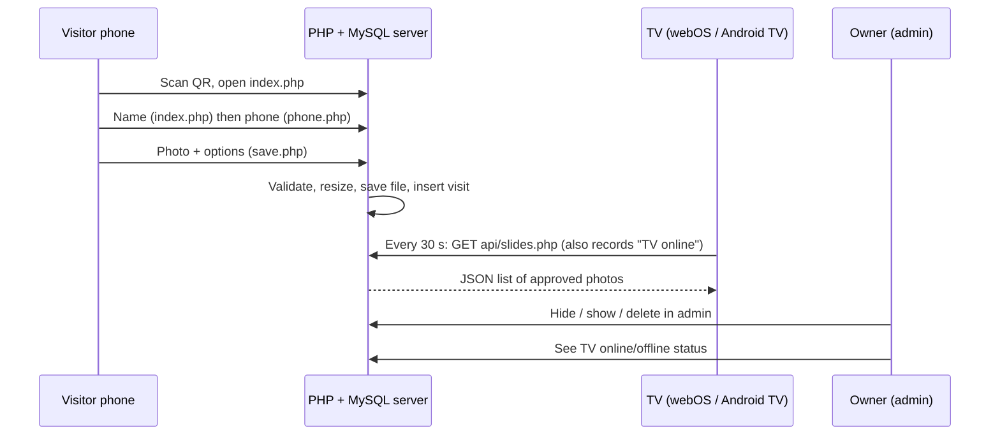

# Architecture

## How it works


## Visitor flow
1. **`index.php`** asks for the name. If the `vtoken` cookie matches a known visitor, the name is prefilled.
2. **`phone.php`** asks for the phone number (7 to 15 digits, optional `+`). Saved in the PHP session.
3. **`photo.php`** shows the visitor's last photo (looked up by phone number), opens the camera, and lets them choose Guest / Family, group photo (size, family name) and tick the consent box.
4. **`save.php`** receives the photo as JSON, validates and re-encodes it, creates or updates the visitor, stores the visit and sets the `vtoken` cookie.
5. **`done.php`** shows the thank-you page.

Returning visitors are recognised two ways: the `vtoken` cookie (same phone) and the phone number (new phone or cleared cookie).

## Database
### `visitors`
| Column | Type | Notes |
|---|---|---|
| id | INT, PK | |
| name | VARCHAR(80) | Latest name used |
| phone | VARCHAR(20), UNIQUE | Identifies the person |
| token | CHAR(32), UNIQUE | Random value stored in the `vtoken` cookie |
| created_at, last_seen | DATETIME | |

### `visits`
| Column | Type | Notes |
|---|---|---|
| id | INT, PK | |
| visitor_id | INT, FK to visitors | Deleted with the visitor |
| visit_type | ENUM('guest','family') | |
| is_group, group_size, family_name | | Group photo details |
| photo_path | VARCHAR(255) | e.g. `uploads/202610/ab12....jpg` |
| approved | TINYINT | `1` = shown on TVs |
| ip | VARCHAR(45) | Used for rate limiting |
| created_at | DATETIME | |

### `tvs`
| Column | Type | Notes |
|---|---|---|
| name | VARCHAR(40), PK | From the `tv` URL parameter, e.g. `Floor 2 TV` |
| platform | VARCHAR(20) | `webOS`, `AndroidTV` or `Browser` |
| last_seen | DATETIME | Online if within the last 90 seconds |

## Endpoints
### `POST /save.php`
JSON body:
```json
{
  "csrf": "token from the page",
  "image": "data:image/jpeg;base64,...",
  "consent": true,
  "type": "guest | family",
  "is_group": false,
  "group_size": 2,
  "family_name": ""
}
```
Response: `{"ok": true}` or `{"ok": false, "error": "..."}` with an HTTP error code (400, 403, 429, 500). Requires the session from steps 1 and 2.

### `GET /api/slides.php?key=TV_KEY&tv=Floor2&p=AndroidTV`
Returns approved photos from the last `SLIDE_HOURS`, newest first, maximum 60:
```json
[
  {"id": 12, "photo": "uploads/202610/ab12.jpg", "is_group": 1, "title": "Sharma Family", "sub": "4 people"},
  {"id": 11, "photo": "uploads/202610/cd34.jpg", "is_group": 0, "title": "Riya", "sub": "Welcome"}
]
```
Wrong or missing `key` returns HTTP 403 and `[]`. Only the **first name** is sent for single photos. The `tv` and `p` parameters update the TV's online status.

## Security measures
| Risk | Mitigation |
|---|---|
| SQL injection | PDO prepared statements everywhere |
| XSS | All output escaped with `e()` |
| CSRF | Token in forms and in the `save.php` request; admin actions need it too |
| Malicious uploads | Only JPEG/PNG data accepted, decoded by GD and **re-encoded** as a new JPEG, random file name, 6 MB limit |
| PHP in uploads | `uploads/.htaccess` denies PHP files (Nginx: see SETUP.md) |
| Spam uploads | Per-phone and per-IP hourly limits; consent required |
| Public TV feed | Needs the secret `TV_KEY`; shows first names only |
| Admin access | Session login, `hash_equals` comparison, session ID regenerated on login |

## Privacy notes
Photos and phone numbers of visitors are personal data. Keep the retention short (`KEEP_DAYS`), keep the consent wording on the photo page, delete a person's photos on request from the admin page, and restrict database and server access.

## Extending
- **SMS/OTP verification:** add a step between `phone.php` and `photo.php`.
- **Owner notification:** send an email or push message from `save.php` after the insert.
- **Real-time TVs:** replace 30-second polling with Server-Sent Events.
- **Hashed admin password:** replace `ADMIN_PASS` with `password_hash()` / `password_verify()`.
